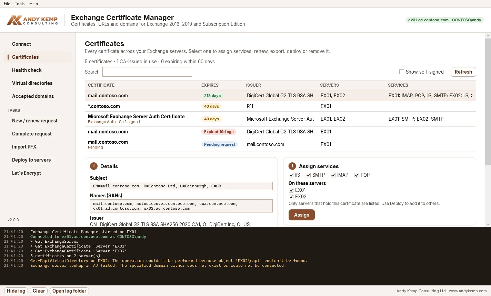
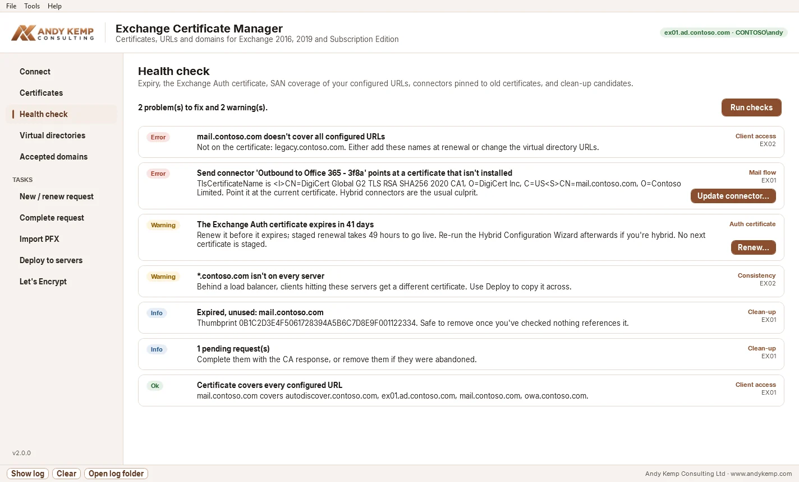
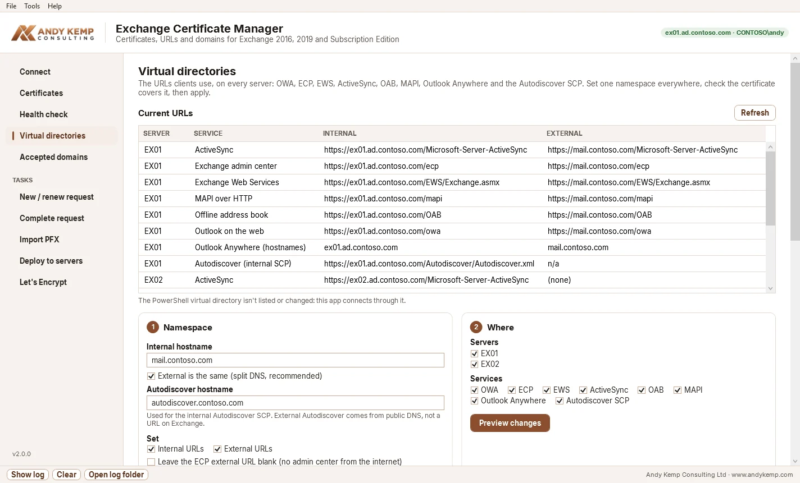

# Exchange Certificate Manager

A Windows app for requesting, renewing, deploying and health-checking Exchange Server certificates, including free Let's Encrypt certificates with automatic renewal. Built by **Andy Kemp Consulting Ltd** with the same look and single-file EXE approach as WinImagePrep.

Supports Exchange 2016, Exchange 2019 and Exchange Server Subscription Edition (SE), including on Windows Server 2025.



Docs: [docs.andykemp.com/exchange-cert-manager](https://docs.andykemp.com/exchange-cert-manager/) · Demo: [demos.andykemp.com/exchange-cert-manager](https://demos.andykemp.com/exchange-cert-manager/) · [tools.andykemp.com](https://tools.andykemp.com/exchange-cert-manager/)

## What it does

| Page | What you get |
|---|---|
| **Connect** | Kerberos sign-in as your current Windows account (or another account). Detects when it's running on an Exchange server and pre-fills it. Works from a domain-joined admin machine too. |
| **Certificates** | Every certificate across every Exchange server, grouped by thumbprint: names, issuer, expiry, which servers hold it and which services each has. Assign services, renew, export PFX, deploy or remove. |
| **Health check** | Expiring certificates in use, the **Exchange Auth (OAuth) certificate**, whether the IIS certificate's SANs cover every URL configured on the virtual directories / Outlook Anywhere / Autodiscover, connectors whose `TlsCertificateName` points at a certificate that's gone (the classic hybrid break), servers missing a certificate the others have, and clean-up candidates. One-click fixes: renew the Auth certificate (staged 49 hours, as Microsoft recommends), clear the previous one, and update a connector's `TlsCertificateName`. |
| **Virtual directories** | Every internal and external URL on every server (OWA, ECP, EWS, ActiveSync, OAB, MAPI, Outlook Anywhere, Autodiscover SCP). Set one namespace with a command preview and a certificate coverage check. The PowerShell vdir is never touched. |
| **New / renew request** | Creates the key on the server and gives you the CSR. "Suggest from Exchange URLs" fills the names in from your configuration. Renew from the Certificates page keeps the same names. |
| **Complete request** | Imports the CA's response on the server with the pending request, assigns services and copies it to the other servers in one step. |
| **Import PFX** | Install a certificate you already have as a .pfx. Checks the file locally first (names, expiry, private key, password) then imports and assigns it on the servers you pick. |
| **Deploy to servers** | Exports once, imports on every server that doesn't have it, assigns the same services everywhere. Shows a summary before it does anything. |
| **Let's Encrypt** | HTTP-01 (writes the challenge to every server's Default Web Site, so it works behind a load balancer) or manual DNS-01 for wildcards. Installs and assigns the certificate, and registers a daily scheduled task that renews within 30 days of expiry. |

| Health check | Virtual directories |
|---|---|
|  |  |

Everything is logged to the panel at the bottom and to `C:\ExchangeCertManager\Logs`.

## Requirements

- Windows 10/11 or Windows Server 2016+, domain-joined
- An account with **Organization Management** (or a role group with the Exchange Server Certificates role)
- HTTP access to `http://<server>/PowerShell` (the standard Exchange remote PowerShell endpoint, Kerberos)
- For Let's Encrypt HTTP validation: port 80 reachable from the internet to Exchange, and admin rights on each server's `C:\inetpub\wwwroot` (local or via the `c$` admin share)

No .NET install is needed; the EXE is self-contained.

## Download and run

Grab `ExchangeCertManager.exe` from the [latest release](https://github.com/andy-kemp/ExchangeServer/releases/latest), copy it somewhere permanent such as `C:\ExchangeCertManager`, and run it. It asks for elevation because it writes ACME challenge files to IIS and can register the renewal task.

## Build

Every push builds the EXE on a Windows runner and captures demo screenshots (`ExchangeCertManager.exe --screenshots <folder>`, sample Contoso data, no Exchange needed). Pushing a `v*` tag publishes a GitHub release with the EXE attached. Run `ExchangeCertManager.exe --demo` to explore the app without Exchange.

```powershell
dotnet publish src/ExchangeCertManager/ExchangeCertManager.csproj -c Release -o publish
```

.NET 8 SDK, WPF, CommunityToolkit.Mvvm, the PowerShell SDK (hosted remote runspace) and Certes (ACME).

## How it talks to Exchange

The Exchange PowerShell endpoint runs in no-language mode, so scripts and script blocks are rejected. The app hosts PowerShell itself and sends each cmdlet as a single command with named parameters, which the endpoint accepts. That's also why the old script's `Invoke-Command` calls didn't work.

## Let's Encrypt notes

- Do a **staging** run first; production has rate limits.
- Leave **SMTP** unticked if you're hybrid. Let's Encrypt certificates change every 60–90 days and their issuer can change, and connectors pinned with `TlsCertificateName` will stop matching.
- The scheduled task runs as an account you choose (a dedicated service account is best) and needs the same Exchange rights plus local admin on the machine running it.
- The ACME account key is stored DPAPI-encrypted under `C:\ProgramData\ExchangeCertManager`, which is restricted to Administrators and SYSTEM.

## Legacy scripts

The original WinForms PowerShell scripts are in [`legacy/`](legacy/) for reference.

## Licence

MIT. Inter font under the SIL Open Font License (see `src/ExchangeCertManager/Fonts/Inter-LICENSE.txt`).
